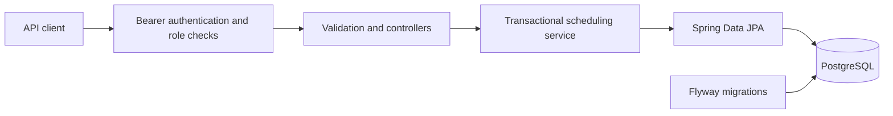

# Appointment Booking

[](https://github.com/ayush01792/appointment-booking/actions/workflows/ci.yml)

An original Java backend for staff scheduling and customer appointment booking. Staff publish 30-minute slots; customers search, book, view their own bookings, and cancel. PostgreSQL enforces schedule and booking constraints under concurrent requests.

## One-command demonstration

With Docker Desktop running and Python 3 installed:

```sh
./scripts/demo.sh
```

The script builds the image, generates random credentials, starts one app and PostgreSQL under a unique disposable Compose project, and assigns a random localhost port. It exercises registration, staff scheduling, eight simultaneous booking requests, ownership, cancellation/rebooking, withdrawal, metrics authorization, and logout. It prints no credentials. On exit it removes only that demo project's containers and volume; your normal development database remains separate.

To save a replayable result and API specification:

```sh
./scripts/demo.sh --report demo-result.json --openapi openapi.json
```

The script reports a failed check as a nonzero exit. Readiness has a five-minute default timeout; `DEMO_READY_TIMEOUT_SECONDS` adjusts it for slower machines. Other API requests default to a 60-second client timeout, configurable with `DEMO_REQUEST_TIMEOUT_SECONDS`. `DEMO_SKIP_BUILD=true` can reuse an image you have just built from the current source. See [the recorded demo](docs/demo-result.json), [OpenAPI snapshot](docs/openapi.json), and [interview notes](docs/interview-notes.md), and [release review](docs/code-review.md).

## Public portfolio demo

Open the [interactive appointment app](https://appointment-booking-17zj.onrender.com/), or explore the [API in Swagger UI](https://appointment-booking-17zj.onrender.com/swagger-ui/index.html). The free instance may take a minute or longer to wake up. The free database expires on **11 November 2026**. See [hosting details](docs/hosting-guide.md) for account access and limits.

## Run locally

Requirements: Java 21, Docker Desktop running, and access to Maven Central. The checked-in Maven wrapper downloads Maven 3.9.16; the build requires Java 21 exactly; a global Maven installation is unnecessary.

```sh
# In the project directory; generated password is for your local database only.
printf 'DB_PASSWORD=%s\n' "$(openssl rand -hex 24)" > .env
chmod 600 .env
set -a
. ./.env
set +a
# Start only PostgreSQL to keep local memory use small.
docker compose up -d db
./mvnw spring-boot:run
```

The database binds to localhost:5433 and the application uses port 8080. Flyway creates the schema; Hibernate validates it rather than silently changing it. `.env` is ignored by Git. The PostgreSQL volume persists across restarts. `docker compose down` stops this project's services and retains data. Do not use `down -v` unless you intend to delete its database.

For the containerized application, use `docker compose up --build -d`. Compose sets database and app memory limits to 256 MB and 512 MB. The local Maven/JVM workflow avoids an additional app container.

## Create staff explicitly

Public registration always creates customers. To create a staff account, stop the application, set the following variables and start it again:

```sh
export BOOTSTRAP_STAFF_ENABLED=true
export BOOTSTRAP_STAFF_EMAIL='staff@example.test'
read -s 'BOOTSTRAP_STAFF_PASSWORD?Choose a staff password (12+ characters, max 72 UTF-8 bytes): '
export BOOTSTRAP_STAFF_PASSWORD
./mvnw spring-boot:run
```

The `read` command above uses zsh, the default macOS shell. For other shells, set the variable through your shell's secure input mechanism. After the first successful startup, stop the app, `unset BOOTSTRAP_STAFF_ENABLED BOOTSTRAP_STAFF_EMAIL BOOTSTRAP_STAFF_PASSWORD`, and restart normally. The bootstrap is idempotent for an existing staff email; it refuses to promote a customer or change an existing password. For Docker, pass these three variables explicitly to the app service with a local Compose override. They are intentionally absent from committed Compose configuration.

## Interactive frontend

Open `/` on the running app. Customers can register, sign in, browse a seven-day calendar, choose a time, confirm a booking, and cancel appointments from their history. Staff can publish 30-minute times and withdraw unbooked openings. Times use the browser’s local timezone. Lists support loading additional pages.

The frontend uses the same-origin API, with no external scripts, fonts, UI framework, or additional build step. Bearer tokens are stored in `sessionStorage` for this tab and revalidated through `GET /api/auth/me` on reload; logout revokes the token. A Content Security Policy restricts scripts and connections to this origin. Appointment responses include slot times so cancelled history stays readable.

## API walkthrough

Open [Swagger UI](http://localhost:8080/swagger-ui.html) or [OpenAPI JSON](http://localhost:8080/v3/api-docs). Register and login are public; all business endpoints require an `Authorization: Bearer <accessToken>` header. Use Swagger's Authorize button after login.

1. `POST /api/auth/register` with `{"email":"customer@example.test","password":"choose-your-own-password"}` creates a customer (201).
2. `POST /api/auth/login` with email/password returns `accessToken`, `tokenType`, and `expiresAt`. Login works for the bootstrapped staff account too.
3. With the staff token, `POST /api/staff/slots` with `{"startsAt":"2026-12-01T09:00:00Z"}` publishes a slot (201). Pick a future timestamp when following this example.
4. With a customer token, `GET /api/slots?from=2026-12-01T00:00:00Z&to=2026-12-02T00:00:00Z` returns available slots. Optional `staffId` filters by staff.
5. `POST /api/bookings` with `{"slotId":"<returned-slot-uuid>"}` books it (201); competing requests return 409.
6. `GET /api/bookings` lists your booking history. `POST /api/bookings/{id}/cancel` cancels your booking and makes the slot available again.
7. `POST /api/auth/logout` revokes the current token (204).

| Endpoint | Access | Purpose |
| --- | --- | --- |
| `GET /api/staff/slots` | Staff | Own published/withdrawn schedule |
| `POST /api/staff/slots` | Staff | Publish a future 30-minute slot |
| `DELETE /api/staff/slots/{id}` | Owning staff | Withdraw a slot with no active booking |
| `GET /api/slots` | Authenticated | Search available future slots |
| `GET /api/bookings` | Customer | Own booking history |
| `POST /api/bookings` | Customer | Book an available slot |
| `POST /api/bookings/{id}/cancel` | Owning customer | Cancel; repeated cancellation is idempotent |

Lists contain up to 50 items; `page` is zero-based and must not exceed 42,949,672 (the JPA offset limit). Timestamp ties are ordered by UUID so paging remains stable for an unchanged dataset. Search windows must be positive and at most 31 days. Staff/customer identities come from the authenticated token, not request bodies. Attempts to modify another person's resource return 404; wrong roles return 403 and invalid/missing tokens return 401. Validation failures return 400; database conflicts return 409, authentication rate limits return 429 with `Retry-After`, and database unavailability returns a sanitized 503. Errors use Problem Details responses and omit SQL/credentials.

## Engineering decisions



- **One application, one database.** The scheduling workflow needs reliable transactions. Extra infrastructure adds no benefit to the current scope.
- **Concurrency is a database concern.** Booking locks the slot row with `SELECT ... FOR UPDATE`. The availability check and insert share one transaction. A partial unique index permits only one booking with `cancelled_at IS NULL` per slot—even an insert that bypasses the service is rejected. Cancellation and withdrawal acquire the same slot lock, so those transitions cannot invalidate a successful booking. Read queries show a snapshot; booking rechecks availability after locking.
- **No overlapping staff slots.** Publication first locks the staff account row to avoid exclusion-index deadlocks between simultaneous inserts for that staff member. A PostgreSQL GiST exclusion constraint rejects intersecting timestamp ranges for the same staff member. Ranges use `[start,end)`, so adjacent appointments are allowed. Withdrawn slots do not reserve time. Different staff can publish simultaneous slots.
- **History is retained.** Cancellation sets a timestamp; withdrawal marks a slot. Rebooking creates a new booking record. Foreign keys preserve account/slot references.
- **Time is explicit.** Requests use ISO-8601 instants with UTC or an offset; storage uses `timestamptz`. Persisted booking and token-expiry timestamps are normalized to [PostgreSQL microseconds](https://www.postgresql.org/docs/17/datatype-datetime.html) so responses remain consistent across platforms and repeated requests. Appointments last exactly 30 minutes. A Java `Clock` makes boundary behavior testable. Slot starts must use whole seconds. The UI/client is responsible for displaying the user's timezone.
- **Simple bearer authentication.** BCrypt hashes passwords. Login creates 256-bit random opaque tokens, valid for one hour. Only SHA-256 token hashes are stored; each request checks token expiry and current account role. Stateless Spring Security accepts no cookie/session authentication, so CSRF protection is disabled for this header-token API. HTTPS is required for a public deployment.

Rules: one staff member per slot; future slots only; no cancellation cutoff (even past bookings can be cancelled); only customers cancel their bookings; booked slots cannot be withdrawn until the customer cancels. Customer overlap across different staff is allowed. Rescheduling means cancel and book again and is not atomic.

## Test

```sh
./mvnw -B verify
# Focused unit tests without Docker:
./mvnw -B -Dtest=SchedulingServiceTest test
```

On Docker Desktop, if socket discovery fails:

```sh
export DOCKER_HOST="unix://$HOME/.docker/run/docker.sock"
export TESTCONTAINERS_DOCKER_SOCKET_OVERRIDE=/var/run/docker.sock
./mvnw -B verify
```

Integration tests start the real HTTP server on a random port and use a fresh PostgreSQL 17.11 Testcontainer with Flyway migrations. Docker is required; unavailable Docker fails these tests instead of silently skipping them. A small Ryuk helper removes test containers when the JVM exits. The database container is limited to 256 MB; the connection pool has six connections. Local Compose uses 32 MB shared buffers and a 20-connection PostgreSQL limit; its healthcheck checks TCP so the temporary initialization server cannot be mistaken for the final server. Surefire XML reports are in `target/surefire-reports/`; the JaCoCo HTML report is `target/site/jacoco/index.html`. Coverage is reported as evidence, not as a substitute for concurrency and ownership checks.

Tests cover concurrent booking, direct unique-index enforcement, simultaneous overlapping schedule publication, withdrawal racing booking, cancellation/rebooking, staff/customer authorization and ownership, request validation, registration, hashed passwords/tokens, token expiry/logout, and OpenAPI generation. GitHub Actions runs the same verify command on Java 21; CI also builds the Docker image and uploads test/coverage reports, including on test failure.

See [verification results](docs/verification.md) for actual local outcomes. These are correctness tests, not throughput or latency benchmarks.

## Operational controls

- Login and registration share a default limit of **20 requests per minute per remote IP**, enforced by a PostgreSQL atomic upsert. Concurrent requests cannot bypass the counter. Fixed windows can permit a burst across the minute boundary; this is an application safeguard, not DDoS protection. Set `APP_AUTH_REQUESTS_PER_MINUTE` to change the limit. Client addresses are stored as SHA-256 fingerprints, not raw addresses; a hash is not an anonymity guarantee.
- Forwarded headers are not trusted by default. Behind a proxy, requests can share its address; configure a trusted ingress before exposing this service publicly rather than blindly trusting client-supplied `X-Forwarded-For`.
- Every 15 minutes, maintenance deletes at most 1,000 expired sessions and 1,000 old rate windows per run. Large backlogs need additional runs; this keeps maintenance transactions bounded. Configure `APP_MAINTENANCE_DELAY_MS` if needed. Booking history remains untouched.
- `GET /actuator/health`, `/actuator/health/liveness`, and `/actuator/health/readiness` are public and hide component details. Readiness includes PostgreSQL; liveness represents the application process. `GET /actuator/metrics` requires a staff token. Sensitive Actuator endpoints such as environment and heap dumps are not exposed.
- Database lock waits are capped at five seconds. Lock conflicts return 409; other database failures return sanitized 503 responses. Transactions are rolled back on failure.
- The app shuts down gracefully with a 20-second request-drain window; Compose allows 30 seconds before stopping the container. The runtime container runs as a non-root user. The Docker build caches Maven dependencies across source changes.

## Dependency baseline

Versions were checked against official sources on 12 October 2026 and resolved from Maven Central:

- Spring Boot **3.5.16**: [stable release index](https://docs.spring.io/spring-boot/) and [3.5 requirements](https://docs.spring.io/spring-boot/3.5/system-requirements.html). Java 21 is the project baseline. A maintained Boot 3 line keeps the conventional Spring MVC/JPA stack straightforward.
- Springdoc **2.9.1**: the [official v2 guide](https://springdoc.org/v2/) recommends the latest v2 stable for Boot 3. Its matrix lists Boot 3.5 against 2.8.x; 2.9.1 was additionally validated here by generating OpenAPI during integration tests.
- Maven **3.9.16**: [official maintained 3.9 release](https://maven.apache.org/download.cgi). The wrapper pins it.
- PostgreSQL **17.11**: [current supported minor for PostgreSQL 17](https://www.postgresql.org/support/versioning/). Development Compose and Testcontainers use the same version.
- GitHub Actions uses [checkout v7](https://github.com/actions/checkout) and [setup-java v6](https://github.com/actions/setup-java), matching their official current usage guides.
- Maven Enforcer **3.6.3** requires Java 21 and Maven 3.9+. JaCoCo **0.8.15** produces line/branch reports; plugin releases were resolved from Maven Central and [JaCoCo documentation](https://www.jacoco.org/jacoco/trunk/doc/maven.html).
- Spring Data, Security, Flyway **11.7.2**, JDBC **42.7.11**, Testcontainers **1.21.4**, JUnit 5, and Mockito are managed by Boot's dependency BOM instead of separately guessing versions.

## Scope and next steps

This is a portfolio scheduling app with a responsive vanilla JavaScript frontend served by Spring Boot. Payment processing, email notifications, Kafka, Redis, and Kubernetes are outside its scope. It is independent of PayFlow. Before operating it as a public service, add verified email/recovery, deployment-specific secret/TLS management, backup/restore procedures, and edge-level abuse controls. Accounts cannot currently be deleted, staff cannot cancel on a customer's behalf, and the free Render deployment has been exercised with sample accounts. Expired sessions and rate-limit windows are already purged automatically in bounded batches.
